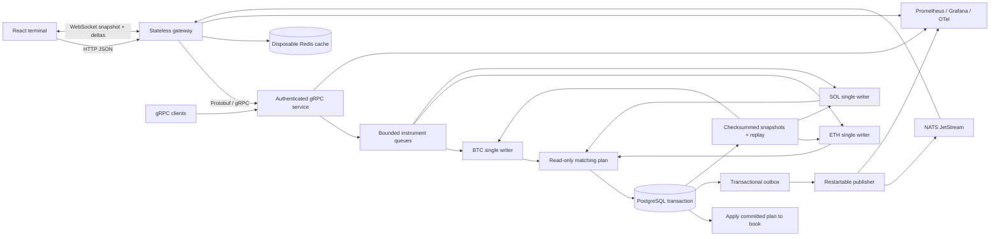

# Architecture

MatchCore is a simulated spot exchange with integer units and no connections to external exchanges or payment systems. The core is a deterministic state machine; transports, persistence and message delivery surround it.

`internal/core` imports only the standard library. It contains instrument configuration, checked arithmetic, order states, an ordered price-level treap and FIFO queues, and matching/cancellation plans. There is no database or clock in that package. A plan contains copies of changed orders and deterministic executions, leaving the visible book untouched.

`internal/engine` starts one goroutine and a bounded 1,024-slot channel for each configured instrument. It owns the book and publishes an immutable depth view for concurrent readers. Queue admission is nonblocking: saturation returns backpressure. Caller cancellation prevents queued work from starting; an already committing command may succeed after a caller disconnects, so the caller must retry the same key. Every command is processed at most once financially through database idempotency, rather than through transport assumptions.

`internal/store` owns the SQL commit, recovery, seeding and outbox. Financial participants are locked in lexical account order and their balance rows in `(account, asset)` order. This serializes competing reservations across instruments without sharing mutable Go balances. A held session advisory lock plus an epoch checked under the instrument row lock fences competing matcher processes.

`internal/transport` implements generated gRPC services, scoped API-key identities, HTTP translation and the WebSocket gateway. A gateway contains no matching state; subscriptions carry a bounded output queue and recover from authoritative snapshots. Redis contains only expiring public last-trade data. Clearing it cannot change orders, trades or balances.

The executable layout is intentionally consolidated: one matching service owns the three instruments; separate gateway, publisher, simulator, acceptance and benchmark commands reuse the domain. Separate empty packages for risk, accounting, replay or query adapters would obscure their transaction boundary. They are cohesive operations within `store`, with the pure arithmetic in `core`.

This is a single-database, single-region simulation. It has fencing, not an automatic leader election system or an active-active order book. Database availability and durability settings determine the durable service's limits. See [consistency](consistency-model.md), [algorithm](matching-algorithm.md) and the [ADRs](adr/).
