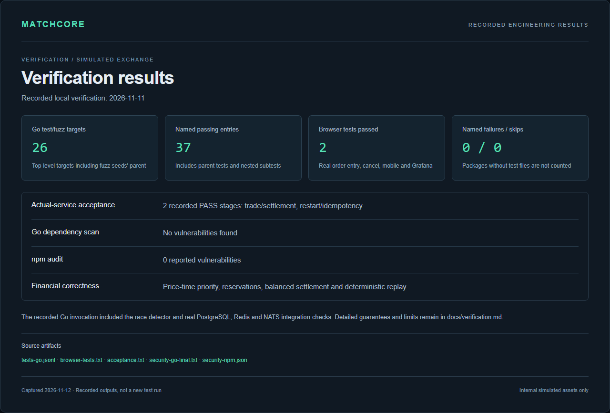
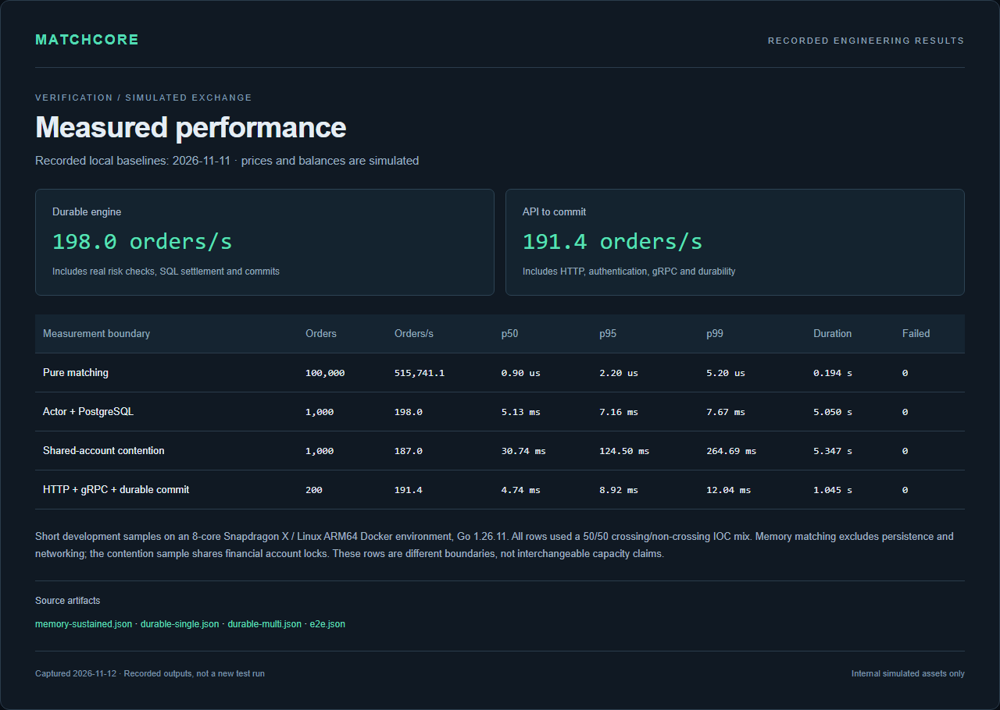
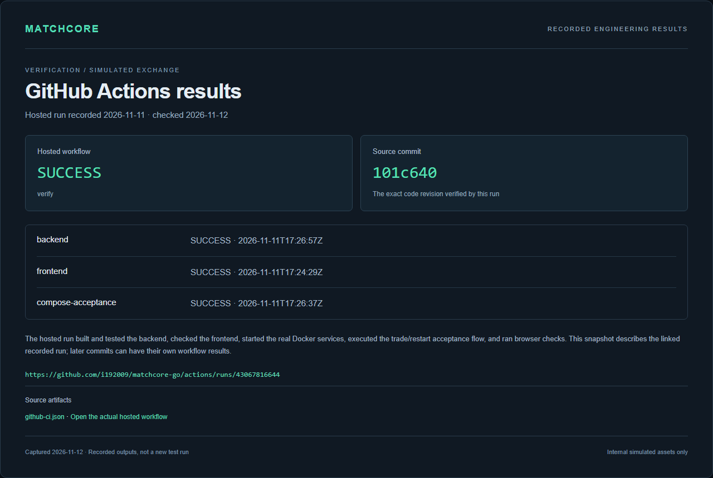
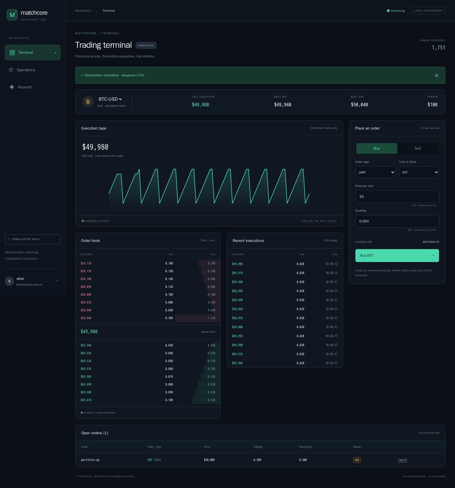
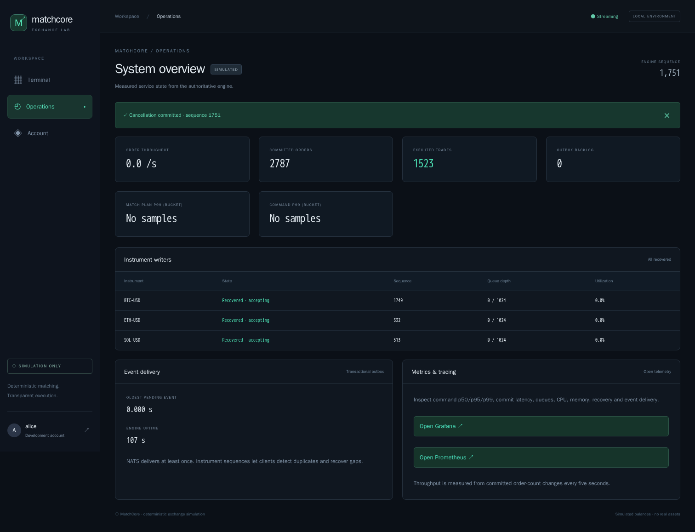
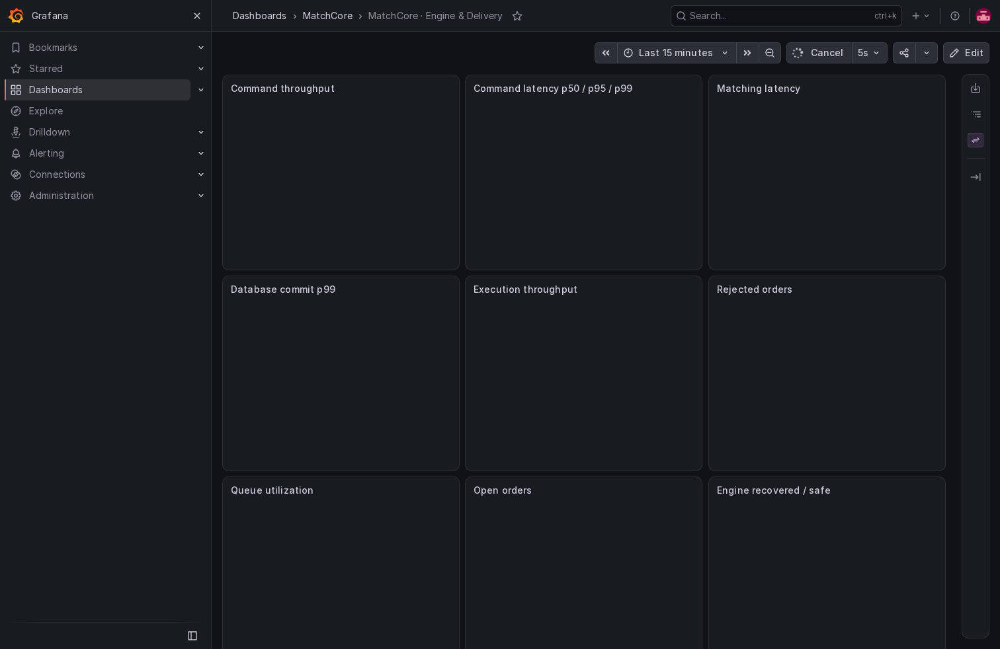

# MatchCore screenshots and results

Application screens were captured on **11 November 2026** from the production React/Nginx build and provisioned Grafana dashboard, using Playwright against real local application services. Additional results-report screenshots were captured on **12 November 2026** from the recorded evidence below.

PostgreSQL, Redis, NATS JetStream, the matching service, outbox publisher and WebSocket gateway were running. Orders, executions, balance reservations and metrics came from those services. Prices and balances are **explicitly simulated**; these images do not represent a real exchange or live market feed.

The browser verified authentication, streaming synchronization, actual order submission and cancellation, account and operations views, mobile layout, and the provisioned Grafana dashboard. The automated acceptance scenario separately verified settlement, fees, SQL/event records and matching-service restart recovery. See [verification details](../docs/verification.md) and [browser output](../benchmarks/results/browser-tests.txt).

| File | Screen | Dimensions |
|---|---|---|
| [terminal.png](terminal.png) | Trading terminal with simulated depth, executions and a resting order | 1512 x 1624 |
| [operations.png](operations.png) | Operations, writer state, queues and measured latency estimates | 1512 x 1157 |
| [account.png](account.png) | Available/reserved assets, fees, executions and transaction journal | 1512 x 22601 |
| [grafana.png](grafana.png) | Provisioned engine and event-delivery metrics dashboard | 1512 x 982 |
| [mobile.png](mobile.png) | Responsive trading terminal at mobile width | 390 x 2790 |

## Recorded verification and performance results

These are screenshots of the included [results report](results/index.html), generated directly from committed test logs, benchmark JSON and [actual hosted workflow metadata](../benchmarks/results/github-ci.json). The underlying tests and measurements ran on **11 November 2026**; the report images were captured on **12 November 2026**. They do not claim a new test run or production capacity. The CI image summarizes the linked real run rather than showing GitHub's website interface.

| File | Result | Dimensions |
|---|---|---|
| [verification-results.png](results/verification-results.png) | Go/race/integration results, browser checks, acceptance stages and dependency scans | 1280 x 867 |
| [benchmark-results.png](results/benchmark-results.png) | Actual in-memory, SQL-durable, shared-account and API latency measurements | 1280 x 910 |
| [github-actions.png](results/github-actions.png) | Successful hosted backend, frontend and Compose/browser jobs for commit 101c640 | 1280 x 860 |

[](results/verification-results.png)

[](results/benchmark-results.png)

[](results/github-actions.png)

## Main views

[](terminal.png)

[](operations.png)

[](grafana.png)

## Reproduce

Follow the [local setup](../README.md#run-it), seed/start the simulator, then run the [Playwright checks](../docs/deployment.md#development-verification). The browser suite writes fresh captures to `docs/screenshots/`; this folder contains the selected publication copies.

To regenerate the results-report images from the committed evidence (without rerunning the application tests):

```sh
python -m pip install playwright
python -m playwright install chromium
python scripts/capture-results.py --capture-date 2026-11-12
```

Use the actual capture date when creating a later set. The original raw measurements remain in `benchmarks/results/` with their recorded dates and methodological limits.
